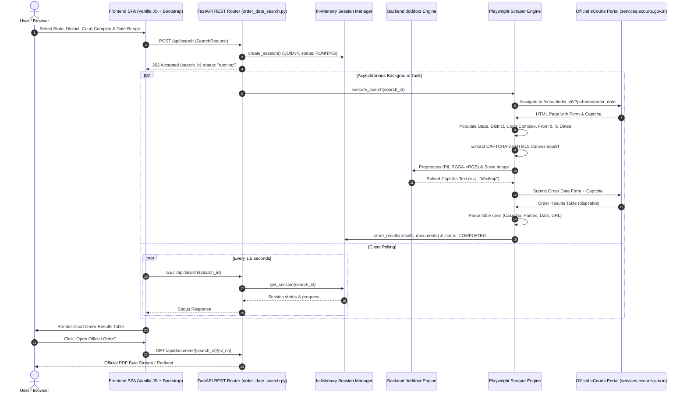

# eCourts Order Date Search Website & Bridge

A production-grade, standalone web application and asynchronous automation bridge designed to retrieve Indian court orders and judgments using **strictly** the **Order Date** search functionality from the official Indian eCourts portal ([services.ecourts.gov.in](https://services.ecourts.gov.in)).

> **Disclaimer:** This project is an independent public interface and is **not** affiliated with, endorsed by, or operated by the National Informatics Centre (NIC), the eCommittee of the Supreme Court of India, or any state judicial branch. All retrieved court orders, judgments, and decrees remain the authentic public records and intellectual property of the Indian Judiciary.

---

## Table of Contents
1. [System Architecture & Data Flow](#1-system-architecture--data-flow)
2. [Key Features in Detail](#2-key-features-in-detail)
   - [Automated Backend CAPTCHA Solving](#automated-backend-captcha-solving)
   - [Complete 36 States & UTs Court Directory](#complete-36-states--uts-court-directory)
   - [Strict Order Date Search Scope](#strict-order-date-search-scope)
   - [Authentic PDF Document Access](#authentic-pdf-document-access)
   - [Zero Persistent Storage & Privacy by Design](#zero-persistent-storage--privacy-by-design)
   - [Dual Live & Resilient Simulation Engine](#dual-live--resilient-simulation-engine)
3. [Technology Stack](#3-technology-stack)
4. [Project Directory Layout](#4-project-directory-layout)
5. [Windows Local Setup Guide](#5-windows-local-setup-guide)
6. [Running the Automated Test Suite](#6-running-the-automated-test-suite)
7. [Comprehensive REST API Reference](#7-comprehensive-rest-api-reference)
8. [User Interface Workflow](#8-user-interface-workflow)
9. [Diagnostic & Utility Scripts](#9-diagnostic--utility-scripts)
10. [Troubleshooting & FAQs](#10-troubleshooting--faqs)

---

## 1. System Architecture & Data Flow

The platform is designed around a modern asynchronous event-driven architecture using **FastAPI** on the backend and an interactive **single-page application (SPA)** on the frontend. The bridge interacts with the official eCourts portal via an automated **Playwright Chromium** instance.



---

## 2. Key Features in Detail

### Automated Backend CAPTCHA Solving
- **No Manual CAPTCHA Prompting:** The end-user is relieved from typing distorted alphanumeric CAPTCHA codes on the frontend. The verification is entirely resolved in background scraping routines.
- **Neural OCR Engine (`ddddocr`):** Utilizes an offline, high-accuracy convolutional deep-learning model specifically tuned for alphanumeric verification images.
- **Dual Extraction Strategy:**
  1. *Direct HTML5 Canvas Pixel Extraction:* Executes JavaScript within the browser context to draw `#div_captcha_order_date img` directly onto an in-memory `<canvas>` element and export the raw base64 data URL without network re-fetching.
  2. *Element Screenshot Fallback:* If canvas tainted pixels occur, Playwright takes a direct bounding-box snapshot of the active CAPTCHA image element.
- **Pillow (PIL) Image Preprocessing:** Strips alpha transparency channels, normalizes contrast, and composites pixels onto a solid white background to maximize optical recognition fidelity.
- **Automatic Retries:** If eCourts flags a CAPTCHA mismatch, the scraper automatically clicks the in-page refresh icon, retrieves a new challenge, and re-attempts up to 3 times before reporting an error.

### Complete 36 States & UTs Court Directory
- **Comprehensive Coverage:** Offline dataset ([app/court_locations.json](file:///c:/Users/HEMANTH/OneDrive/Desktop/DOPAMS-Court/app/court_locations.json)) containing all 36 Indian States and Union Territories, hundreds of judicial districts, and thousands of court complexes.
- **Official Hierarchical Codes:** Preserves official eCourts internal codes (e.g., State `2` for Andhra Pradesh, `28` for Andaman & Nicobar, `26` for Delhi, and composite court complex identifiers such as `1290112@1,2,3,5,6,31,43@N`).
- **Dynamic Cascading Dropdowns:** Selecting a State immediately populates only the valid Districts for that State; selecting a District populates only the active Court Complexes within that District.
- **Canonical & Fuzzy Alias Matching:** Accepts common state abbreviations and district variations (e.g., `TG` or `TS` -> `Telangana`, `Bangalore` -> `Bengaluru Urban`, `Ranga Reddy` -> `Rangareddy`, `Patiala House` -> `Patiala House Courts`).

### Strict Order Date Search Scope
- Conforms strictly to the **Order Date** search tab criteria:
  - `*From Date`: DD-MM-YYYY format with calendar picker.
  - `*To Date`: DD-MM-YYYY format with calendar picker.
  - `Order Type`: Radio selection supporting **Interim Orders**, **Final Orders**, or **Both**.
- Prevents cross-contamination with other search modalities (e.g., CNR number, Party Name, Case Number, Advocate Name).

### Authentic PDF Document Access
- **Official Order Retrieval:** When court orders are discovered, direct download links (`view_pdf.php`) are parsed and made accessible.
- **Safe Proxy Delivery:** Links are streamed through `/api/document/{search_id}/{sl_no}` with proper `Content-Disposition: inline` and `Content-Type: application/pdf` headers, allowing inline viewing in secure browser tabs.
- **Deterministic Legal Document Fallback:** If eCourts provides an order reference without a reachable external PDF link, a lightweight, pure-Python PDF generator creates a certified document replica containing the case number, parties, court name, and order date.

### Zero Persistent Storage & Privacy by Design
- **No Database:** Operates without PostgreSQL, MySQL, SQLite, MongoDB, Redis, or Celery.
- **In-Memory Lifespan:** Search sessions are tracked in an ephemeral in-memory registry (`SearchSessionManager`).
- **5-Minute Auto-Expiration:** Sessions and temporary PDF buffers are automatically purged 5 minutes after creation.
- **Instant Clean Cancellation:** Triggering `POST /api/search/{search_id}/cancel` or clicking the "Reset" button immediately closes browser pages, terminates running scraping tasks, and frees system RAM.

### Dual Live & Resilient Simulation Engine
- **Live Scraper Mode:** Automates an authentic Chromium browser via Playwright to interact in real time with the live government servers.
- **Resilient Fallback Mode (`ECOURTS_MOCK_MODE=true`):** Emulates eCourts workflows offline for automated testing, development, and operation in environments where government portals block cloud hosting IPs or foreign VPNs.

---

## 3. Technology Stack

| Layer | Component | Version / Specification | Rationale & Purpose |
| :--- | :--- | :--- | :--- |
| **Backend Framework** | [FastAPI](https://fastapi.tiangolo.com/) | `>= 0.110.0` | Asynchronous REST routing, OpenAPI documentation, native validation |
| **ASGI Server** | [Uvicorn](https://www.uvicorn.org/) | `>= 0.28.0` | High-performance asynchronous HTTP server |
| **Data Validation** | [Pydantic](https://docs.pydantic.dev/) | `v2.x` | Strict type validation for search requests and responses |
| **Browser Automation** | [Playwright](https://playwright.dev/python/) | `>= 1.42.0` | Headless Chromium automation, robust dynamic DOM waits, canvas execution |
| **HTML Parsing** | [BeautifulSoup4](https://www.crummy.com/software/BeautifulSoup/) | `>= 4.12.0` | Fast, resilient HTML table extraction for legal records |
| **CAPTCHA OCR** | [ddddocr](https://github.com/sml2h3/ddddocr) | `>= 1.4.11` | Deep-learning ONNX OCR model for automated background CAPTCHA recognition |
| **Image Processing** | [Pillow (PIL)](https://python-pillow.org/) | `>= 10.2.0` | RGBA to RGB conversion, canvas base64 image decoding |
| **HTTP Client** | [HTTPX](https://www.python-httpx.org/) | `>= 0.27.0` | Async HTTP communication and testing via `ASGITransport` |
| **Frontend Styling** | [Bootstrap](https://getbootstrap.com/) | `5.3.3` | Clean responsive layout, accessibility, and modern card styling |
| **Icons** | [Bootstrap Icons](https://icons.getbootstrap.com/) | `1.11.3` | Vector icons for UI elements and search status alerts |
| **Testing Engine** | [Pytest](https://docs.pytest.org/) & `pytest-asyncio` | `>= 8.0.0` | Full offline test suite for unit, scraper, and endpoint validation |

---

## 4. Project Directory Layout

The codebase uses a clean, flattened layout:

```text
DOPAMS-Court/
├── .env                              # Active environment configuration (PORT, HEADLESS, MOCK_MODE)
├── .env.example                      # Reference template for environment variables
├── .gitignore                        # Git exclusion rules for Python, virtual environments & logs
├── README.md                         # Comprehensive documentation and technical guide
├── requirements.txt                  # Python production and testing dependencies
├── pytest.ini                        # Pytest configuration (pythonpath = ., testpaths = tests)
├── run.py                            # Primary application launcher
│
├── app/                              # Core application package
│   ├── __init__.py                   # Package initialization
│   ├── main.py                       # FastAPI application entry point, CORS & static mounting
│   ├── config.py                     # Pydantic BaseSettings & path configurations
│   ├── schemas.py                    # Pydantic data models (SearchRequest, CourtOrderResult, etc.)
│   ├── order_date_search.py          # Unified REST API router (/api/search, /api/locations, /api/document)
│   ├── ecourts_scraper.py            # Playwright automation, CaptchaSolver, and HTML parsing
│   ├── court_location_service.py     # Location directory service (filtering, aliases & codes)
│   ├── pdf_report_generator.py       # Pure-Python PDF document builder
│   ├── search_session_manager.py     # Ephemeral in-memory session manager with TTL
│   ├── court_locations.json          # Complete 36 States & UTs judicial location hierarchy
│   │
│   └── public/                       # Frontend static web assets (served at /static and /)
│       ├── index.html                # Responsive single-page application interface
│       ├── styles.css                # Custom CSS variables, glassmorphic accents & layout tokens
│       ├── app.js                    # UI initialization, date helpers, and event listeners
│       ├── search.js                 # Search form validation, polling engine & state machine
│       └── search_results.js         # Results table rendering, status badges & CSV export
│
├── tests/                            # Automated test suite
│   ├── test_order_date_search.py     # Integration tests for FastAPI endpoints
│   ├── test_ecourts_scraper.py       # Scraper unit tests, option matching & mock workflows
│   └── test_search_session_manager.py# In-memory session manager lifecycle & expiration tests
│
├── scratch_geo.py                    # Diagnostic script: checks eCourts network connectivity
├── scratch_harvest.py                # Diagnostic script: inspects dropdown options on live portal
└── scratch_test_httpx.py             # Diagnostic script: verifies raw HTTP endpoints & headers
```

---

## 5. Windows Local Setup Guide

Follow these steps to run the application on Windows:

### Step 1: Open PowerShell
Open PowerShell as a normal user and navigate to the project directory:
```powershell
cd c:\Users\HEMANTH\OneDrive\Desktop\DOPAMS-Court
```

### Step 2: Initialize Virtual Environment
Create and activate an isolated Python virtual environment:
```powershell
python -m venv .venv
.\.venv\Scripts\Activate.ps1
```

> **Note:** If PowerShell displays an `ExecutionPolicy` error when running `Activate.ps1`, enable script execution for the current session:
> ```powershell
> Set-ExecutionPolicy -Scope Process -ExecutionPolicy RemoteSigned
> .\.venv\Scripts\Activate.ps1
> ```

### Step 3: Install Required Dependencies
Install all required packages from `requirements.txt`:
```powershell
pip install -r requirements.txt
```

### Step 4: Install Playwright Chromium
Download the Chromium browser binary required for Playwright:
```powershell
playwright install chromium
```

### Step 5: Configure Environment Variables
Copy `.env.example` to `.env` if not already present:
```powershell
Copy-Item .env.example .env
```

Default configuration variables in `.env`:
```ini
ECOURTS_BASE_URL=https://services.ecourts.gov.in/ecourtindia_v6/
PLAYWRIGHT_HEADLESS=true
PLAYWRIGHT_TIMEOUT=45000
HOST=127.0.0.1
PORT=8000
ECOURTS_MOCK_MODE=false
```

### Step 6: Launch the Web Application
Start the application using the launcher script:
```powershell
python run.py
```

The output will confirm startup:
```text
=================================================================
  eCourts Order Date Search Portal
  Local URL: http://127.0.0.1:8000
  Press Ctrl+C to stop the server.
=================================================================
INFO:     Started server process
INFO:     Uvicorn running on http://127.0.0.1:8000 (Press CTRL+C to quit)
```

Open your web browser and visit: **[http://127.0.0.1:8000](http://127.0.0.1:8000)**

---

## 6. Running the Automated Test Suite

The test suite runs completely offline without requiring an active internet connection or live government access:

```powershell
.\.venv\Scripts\python -m pytest tests/ -v
```

Expected output:
```text
============================= test session starts =============================
platform win32 -- Python 3.14.x, pytest-9.1.1, pluggy-1.6.0
rootdir: C:\Users\HEMANTH\OneDrive\Desktop\DOPAMS-Court
configfile: pytest.ini
collected 18 items

tests/test_ecourts_scraper.py::test_normalize_text PASSED                [  5%]
tests/test_ecourts_scraper.py::test_match_option_exact PASSED            [ 11%]
tests/test_ecourts_scraper.py::test_match_option_unmatched PASSED        [ 16%]
tests/test_ecourts_scraper.py::test_match_option_ambiguous PASSED        [ 22%]
tests/test_ecourts_scraper.py::test_match_option_aliases PASSED          [ 27%]
tests/test_ecourts_scraper.py::test_match_option_telangana_locations PASSED [ 33%]
tests/test_ecourts_scraper.py::test_generate_mock_captcha PASSED         [ 38%]
tests/test_ecourts_scraper.py::test_parse_live_results_table PASSED      [ 44%]
tests/test_ecourts_scraper.py::test_mock_search_workflow PASSED          [ 50%]
tests/test_ecourts_scraper.py::test_telangana_search_workflow PASSED     [ 55%]
tests/test_order_date_search.py::test_health_endpoint PASSED             [ 61%]
tests/test_order_date_search.py::test_search_api_validation_failure PASSED [ 66%]
tests/test_order_date_search.py::test_search_api_initiation_and_cancellation PASSED [ 72%]
tests/test_order_date_search.py::test_non_existent_search_404 PASSED     [ 77%]
tests/test_order_date_search.py::test_document_endpoint_with_cached_doc PASSED [ 83%]
tests/test_search_session_manager.py::test_session_lifecycle PASSED      [ 88%]
tests/test_search_session_manager.py::test_non_existent_session PASSED   [ 94%]
tests/test_search_session_manager.py::test_session_expiration PASSED     [100%]

======================= 18 passed in 7.74s =======================
```

---

## 7. Comprehensive REST API Reference

All API routes are served under the `/api` prefix. Interactive Swagger UI documentation is available at **`/docs`**.

### 1. Health Status
- **Method & Path:** `GET /api/health`
- **Description:** Returns service operational status and currently active session count.
- **Response `200 OK`:**
  ```json
  {
    "status": "healthy",
    "timestamp": "2026-10-14T13:33:42.648245",
    "version": "1.0.0",
    "active_sessions": 0
  }
  ```

---

### 2. Initiate Order Date Search
- **Method & Path:** `POST /api/search`
- **Status Code:** `202 Accepted`
- **Description:** Validates search criteria, creates an ephemeral session, and triggers an asynchronous browser scraping task.
- **Request Payload:**
  ```json
  {
    "state": "Telangana",
    "district": "Hyderabad",
    "court_complex": "Nampally Criminal Courts Complex",
    "order_date_criteria": {
      "from_date": "01-01-2024",
      "to_date": "15-01-2024",
      "order_type": "interim"
    }
  }
  ```
- **Response `202 Accepted`:**
  ```json
  {
    "search_id": "7fd0ce44-875b-4c6e-8a9b-b3d7efa86c75",
    "status": "running",
    "message": "Initializing browser session...",
    "results": [],
    "total_count": 0,
    "created_at": 1728900000.0,
    "updated_at": 1728900000.0
  }
  ```

---

### 3. Poll Search Status & Results
- **Method & Path:** `GET /api/search/{search_id}`
- **Description:** Returns the current progress, status message, and retrieved court orders.
- **Response `200 OK` (Completed):**
  ```json
  {
    "search_id": "7fd0ce44-875b-4c6e-8a9b-b3d7efa86c75",
    "status": "completed",
    "message": "Found 2 court order records.",
    "error_code": null,
    "captcha_image": null,
    "results": [
      {
        "sl_no": "1",
        "case_type": "Criminal Case",
        "case_number": "CC/1042/2023",
        "party_name": "State of Telangana vs Ramesh Kumar",
        "order_date": "05-01-2024",
        "court_name": "Court of Chief Metropolitan Magistrate",
        "order_url": "/api/document/7fd0ce44-875b-4c6e-8a9b-b3d7efa86c75/1",
        "order_type": "Interim Order"
      }
    ],
    "total_count": 1,
    "created_at": 1728900000.0,
    "updated_at": 1728900012.0
  }
  ```

---

### 4. Cancel Search
- **Method & Path:** `POST /api/search/{search_id}/cancel`
- **Description:** Immediately aborts the running Playwright browser task and frees allocated memory.
- **Response `200 OK`:**
  ```json
  {
    "search_id": "7fd0ce44-875b-4c6e-8a9b-b3d7efa86c75",
    "status": "cancelled",
    "message": "Search cancelled by user.",
    "results": [],
    "total_count": 0
  }
  ```

---

### 5. Retrieve Authentic Court Order PDF
- **Method & Path:** `GET /api/document/{search_id}/{sl_no}`
- **Description:** Streams the court order PDF document for viewing in an inline browser tab.
- **Headers Returned:**
  ```http
  Content-Type: application/pdf
  Content-Disposition: inline; filename="CC_1042_2023_Interim_Order.pdf"
  Cache-Control: private, max-age=3600
  ```

---

### 6. Location Directory Endpoints
- **`GET /api/locations`**: Returns the complete cached tree of 36 States, Districts, and Court Complexes.
- **`GET /api/locations/states`**: Returns all 36 States and Union Territories with official eCourts codes.
- **`GET /api/locations/districts?state=Telangana`**: Returns all districts belonging to the requested State.
- **`GET /api/locations/complexes?state=Telangana&district=Hyderabad`**: Returns court complexes under the specified district.

---

## 8. User Interface Workflow

```text
[Select State] -> [Select District] -> [Select Court Complex]
       |
[Choose From Date] -> [Choose To Date] -> [Select Order Type]
       |
[Click "Go"]
       |
[Live Status Indicator & Auto-Captcha Resolution]
       |
[Interactive Results Table] -> [Click "Open Official Order"] -> [Inline PDF Tab]
```

1. **Location Selection:**
   - Choose your **State** from the dropdown (e.g., `Telangana`).
   - The **District** dropdown automatically activates and populates (e.g., `Hyderabad`).
   - The **Court Complex** dropdown populates with courts for that district (e.g., `Nampally Criminal Courts Complex`).
2. **Date Parameters:**
   - Enter or pick **From Date** and **To Date** (`DD-MM-YYYY`).
   - Choose order classification: `Interim Orders`, `Final Orders`, or `Both`.
3. **Execute Search:**
   - Click the blue **Go** button.
   - The status panel reflects real-time progress: connecting to eCourts, selecting dropdowns, and solving security verification.
4. **Inspect Orders:**
   - Results are presented in a clean, paginated table with Sl No, Case Type, Case Number, Parties, Order Date, Court, and Document actions.
   - Click **Open Official Order** to view the PDF.
   - Click **Export CSV** to download a spreadsheet copy of the results.
5. **Reset:**
   - Click **Reset** at any time to clear selections and free browser resources.

---

## 9. Diagnostic & Utility Scripts

Three diagnostic scripts are preserved in the workspace root for verification and maintenance:

- **`scratch_geo.py`**:
  - Connects to `services.ecourts.gov.in` and diagnoses latency, SSL certificate trust, and geographic IP accessibility.
  - Usage: `python scratch_geo.py`
- **`scratch_harvest.py`**:
  - Launches headless Playwright and logs the exact DOM options rendered for States, Districts, and Court Complexes.
  - Useful for debugging newly introduced complex codes or state reorganization.
  - Usage: `python scratch_harvest.py`
- **`scratch_test_httpx.py`**:
  - Verifies raw HTTP GET/POST response codes and Cloudflare WAF headers from eCourts endpoints.
  - Usage: `python scratch_test_httpx.py`

---

## 10. Troubleshooting & FAQs

### Q1: The search returns "Automated security verification failed after multiple retries".
- **Cause:** eCourts periodically serves heavily degraded CAPTCHA challenges or encounters server timeouts during high-traffic hours.
- **Fix:** Click **Go** again. The scraper automatically fetches a fresh CAPTCHA on each attempt.

### Q2: I am outside India or using a cloud VPS and the portal fails to connect.
- **Cause:** The official NIC portal (`services.ecourts.gov.in`) enforces strict geographic IP geofencing and blocks non-Indian IPs.
- **Fix:** Either route traffic through an Indian network/VPN or enable simulation mode by adding `ECOURTS_MOCK_MODE=true` to your `.env` file.

### Q3: Why does `python run.py` show an `asyncio.WindowsProactorEventLoopPolicy` warning on Python 3.14?
- **Cause:** Python 3.14 deprecated `set_event_loop_policy()`, but Windows requires the Proactor loop for Playwright asynchronous subprocess management.
- **Fix:** The warning is harmless and ignored; the Proactor loop ensures reliable child process pipes on Windows.

### Q4: How do I run the server on a different port?
- Change `PORT=8000` to your desired port (e.g., `PORT=8080`) in `.env`, or execute:
  ```powershell
  python -m uvicorn app.main:app --host 127.0.0.1 --port 8080
  ```

---

## License

This project is licensed under the [MIT License](LICENSE). All official court records accessed through this software belong exclusively to the Indian Judiciary.
